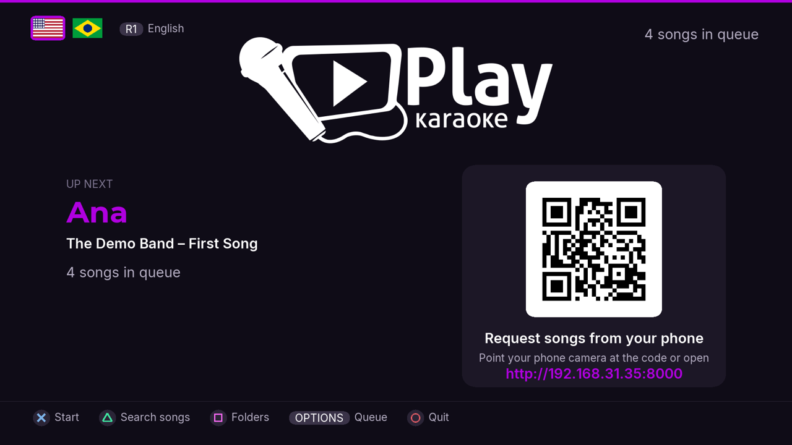
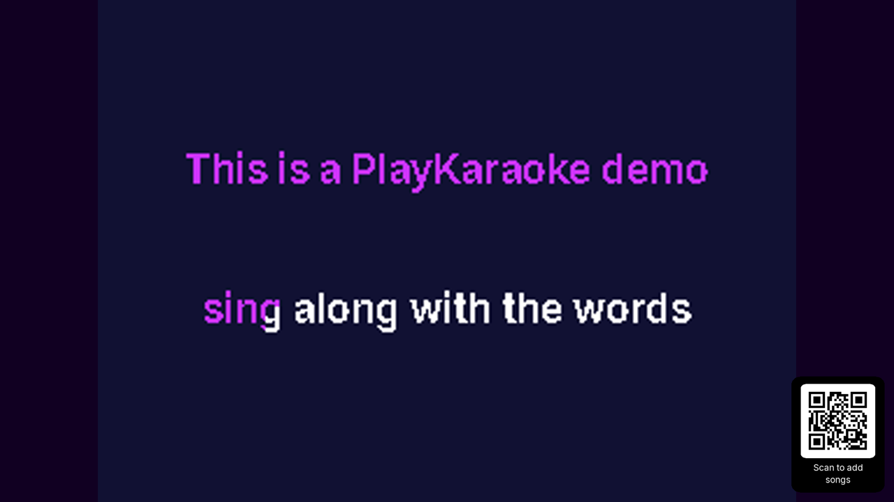
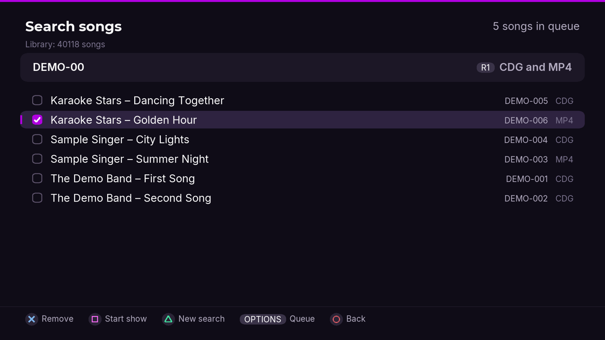
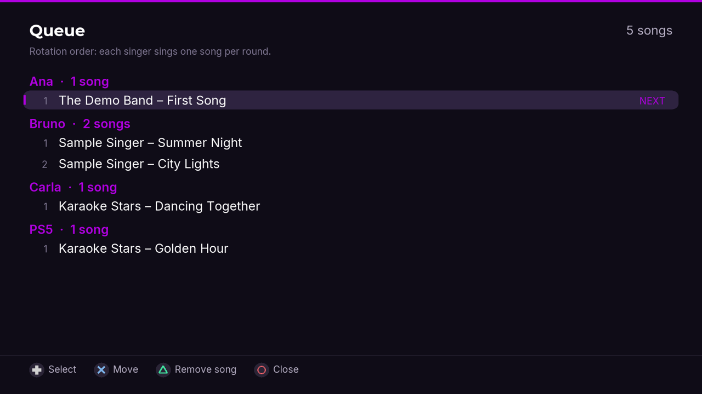
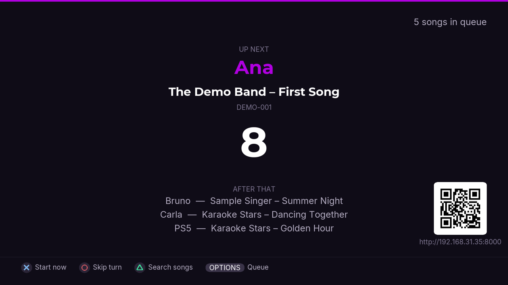
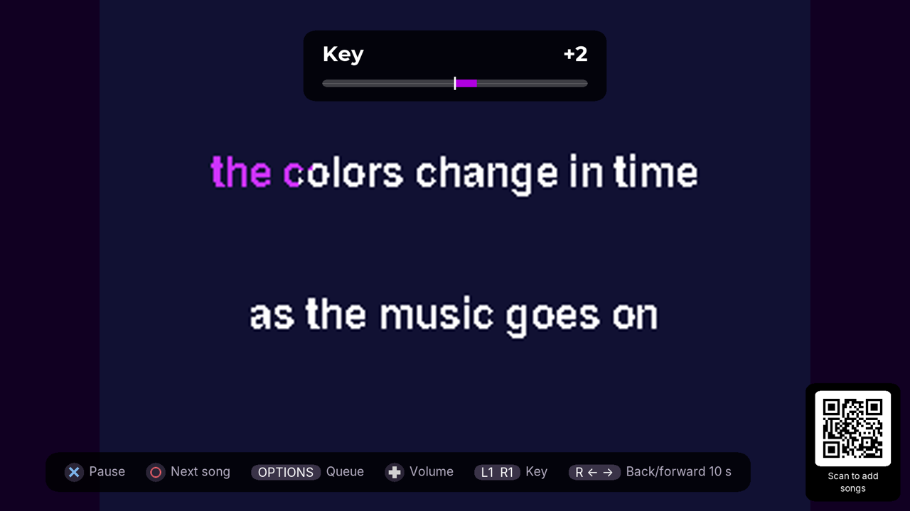
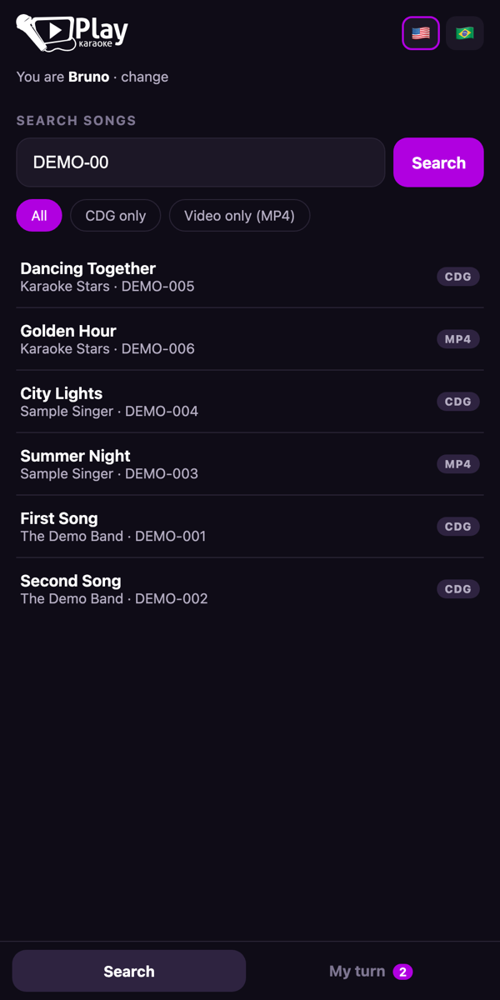
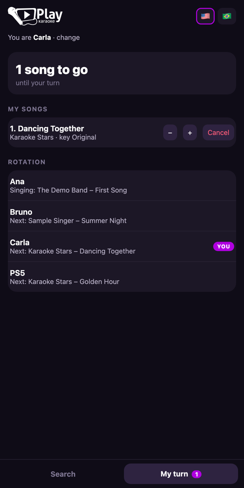
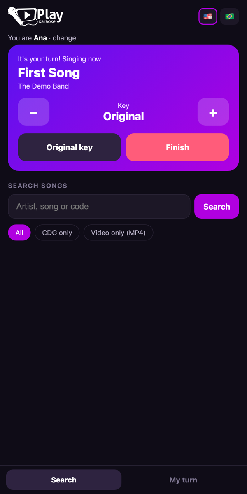

<p align="center">
  
</p>

<h1 align="center">PlayKaraoke for PS5</h1>

<p align="center">
  A karaoke player for jailbroken PS5 consoles: <b>CDG (MP3+G)</b> and <b>MP4</b>, real-time key change,
  a singer rotation, and guests requesting songs <b>from their phones</b> with a QR code on the TV.<br/>
  Homebrew version of the <a href="https://github.com/PlayKaraoke/PlayKaraokeWebPlayer">PlayKaraoke Web Player</a>.
</p>

> ⚠️ **Experimental beta — use at your own risk.** PlayKaraoke runs on a jailbroken console and writes to
> system areas (it registers a dashboard tile and an app host). It has no affiliation with Sony.
> Back up your saves and **close any running game before opening PlayKaraoke**.

<p align="center">
  
  
</p>

> 🎵 **No music included.** This project is only a player. It does not include, distribute or point to
> karaoke files, artist names or songs. Only use files you have the right to use.

## Features

- **Formats:** `.zip` with `.cdg` + audio (MP3+G) and `.mp4` video (up to 4K)
- **Key change:** ±12 semitones in real time, without changing speed, for CDG and MP4
- **Phones:** guests scan the QR code, type their name, search the library and request songs; they see
  how many songs are left until their turn and can change the key or finish their song
- **Singer rotation:** one song per singer per round, in order of arrival, up to 5 songs each
- **Search:** accent-insensitive search by artist, title or code, CDG/MP4 filter, alphabetical results
- **DualSense only mode:** you can run a whole night with just the controller
- **Languages:** English and Portuguese (Brazil)

## Screenshots

<p align="center">
  
  
  
  
</p>

<p align="center">
  
  
  
</p>

<p align="center"><sub>Screenshots use the made-up demo songs from <code>tools/make-demo-songs.py</code>.</sub></p>

## Requirements

- A jailbroken PS5 with an ELF loader (**elfldr**, port 9021). **Tested on firmware 13.60.** Earlier
  firmwares that run elfldr should work but are untested.
- An external drive with your karaoke files, formatted as **exFAT** (or FAT32). NTFS and APFS are not
  supported by the PS5.
- Phones on the same Wi-Fi network as the PS5 (optional).

## Installation

1. Download `playkaraoke.elf` from the [latest release](../../releases/latest).
2. Send it to the PS5 elfldr (port 9021), the same way you load any payload. For example, from a computer:
   `nc -q0 <PS5-IP> 9021 < playkaraoke.elf` (or use your favorite payload sender).
3. A notification says PlayKaraoke is ready. Open **PlayKaraoke** in the **Media** section of the home screen.

The payload installs everything by itself (`/data/playkaraoke` and the Media tile) and stays resident to
open the app. **Send it again after every jailbreak.** Sending a newer version updates it in place.

When the app opens, the PS5 web browser also shows a quick guide on top of it: press **○** to close it.

## How to use

1. Connect the drive **before** opening the app. The first time, PlayKaraoke reads the drive in the
   background and builds the library (it is updated every time the app opens).
2. On the home screen, guests scan the **QR code** to request songs from their phones. You can also
   search with the controller (**△**).
3. Press **✕ Start** (or **▢ Start show** in the search) to start. A 10-second countdown shows who sings next.
   After the show starts, new requests start automatically when the queue is idle.

### Phones and the PS5 address

Every PS5 has its own address (IP) on your network, so there is nothing to configure: when PlayKaraoke
opens, it finds its own address and shows it under the QR code (for example `http://192.168.0.25:8000`).
Guests just scan the code, or type that address in the phone browser.

- The phones must be on the **same Wi-Fi** as the PS5 (no internet needed).
- Each guest types a name once; the phone remembers it. One song per singer per round, up to 5 each.
- On the phone: search and request songs, see how many songs are left until your turn, cancel your songs,
  change their key and, when it is your turn, change the key live or finish your song.
- During a song, a small QR code stays in the bottom-right corner so new guests can join.
- If the address changes (the router gives the PS5 a new one), the QR code updates the next time the app opens.

### Controller

| Where | Button | Action |
|---|---|---|
| Home | △ / ▢ / ✕ / ○ | Search songs / Folders / Start / Quit |
| Home | R1 | Language (🇺🇸 English / 🇧🇷 Português) |
| Search | ✕ | Add to / remove from the queue |
| Search | ▢ | Start the show |
| Search | △ / R1 | New search (PS5 keyboard) / CDG, MP4 or both |
| Anywhere | OPTIONS | Queue: see the rotation, move (✕) or remove (△) songs |
| Countdown | ✕ / ○ | Start now / Skip this turn |
| Playing | ✕ / ○ | Pause / End the song |
| Playing | ↑ ↓ or left stick | Volume |
| Playing | L1 / R1 | Key −1 / +1 |
| Playing | Right stick ← → | Back / forward 10 seconds |
| Playing | Touchpad | Show the controls bar |

### File names

Song info is read from the file name: `Code - Artist - Title`

```
SC8123-05 - Artist Name - Song Title.zip   → code, artist, title
Artist Name - Song Title.mp4                → artist, title
```

A `.zip` must contain one `.cdg` and its audio (`.mp3`, `.wav`, `.ogg` or `.m4a`).

## FAQ

**The drive does not show up.** Check that it is exFAT or FAT32 and connected before opening the app.
Drives formatted on a Mac have a small hidden EFI partition; PlayKaraoke hides it and shows the main one.

**A browser window stays on top of the app.** That is how the dashboard tile opens homebrew. Press ○ once.

**Phones cannot open the page.** The phone must be on the same Wi-Fi as the PS5, and the app must be open.

**Will it close my game?** No. If a game or app is open, PlayKaraoke shows a message and does nothing.

## Demo songs

No karaoke files at hand? `tools/make-demo-songs.py` generates six royalty-free demo songs (CDG zips and
MP4s with made-up lyrics and synthesized music). Needs Python 3 with Pillow and ffmpeg:

```
python3 tools/make-demo-songs.py demo-songs
```

Copy them to your drive (or to `/data/playkaraoke/test` on the PS5) and open the app.

## Building

Requires Docker. The build uses the [ps5-payload-sdk](https://github.com/ps5-payload-dev/sdk) and the
[PacBrew](https://github.com/ps5-payload-dev/pacbrew-repo) libraries (`v0.41.1`).

```
scripts/ps5.sh release                    # dist/playkaraoke.elf (public build)
scripts/ps5.sh build                      # development build (build/playkaraoke.elf)
PS5_HOST=<PS5-IP> scripts/ps5.sh          # build and send to elfldr
tests/run.sh                              # unit tests (host)
```

## Credits and licenses

PlayKaraoke for PS5 is licensed under **GPL-3.0-or-later** (see [LICENSE](LICENSE)).

| Component | License | Notes |
|---|---|---|
| BigApp loader core (`src/launcher/core`) from [ps5-payload-websrv](https://github.com/ps5-payload-dev/websrv) by John Törnblom | GPL-3.0-or-later | Commit `7748df9`; `hbldr.c` changed to use PlayKaraoke's own Media app host |
| [qrcodegen](https://github.com/nayuki/QR-Code-generator) by Project Nayuki (`vendor/qrcodegen`) | MIT | v1.8.0, unchanged |
| [ps5-payload-sdk](https://github.com/ps5-payload-dev/sdk) | GPL-3.0-or-later | Toolchain and runtime |
| SDL2, SDL2_ttf, SDL2_image, SDL2_gfx | zlib | Via PacBrew |
| FFmpeg | LGPL/GPL | Via PacBrew |
| libmicrohttpd | LGPL-2.1 | Via PacBrew |
| minizip, zlib | zlib | Via PacBrew |
| [Inter](https://github.com/rsms/inter) and [Montserrat](https://github.com/JulietaUla/Montserrat) fonts | SIL OFL 1.1 | `assets/fonts` |

The CDG decoder, pitch shifter, queue rotation and file-name parsing are ports of the
PlayKaraoke Web Player by the same author. The PlayKaraoke name and logo belong to their owner.

## Support

PlayKaraoke is free. More from PlayKaraoke on [YouTube](https://www.youtube.com/@playkaraoke).
