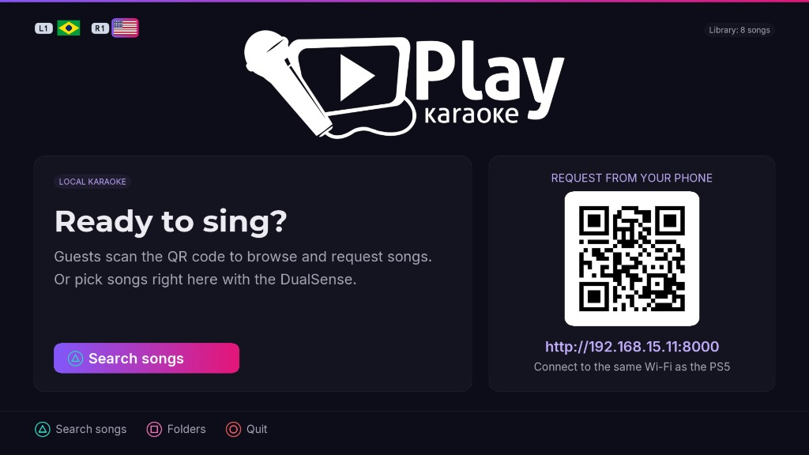
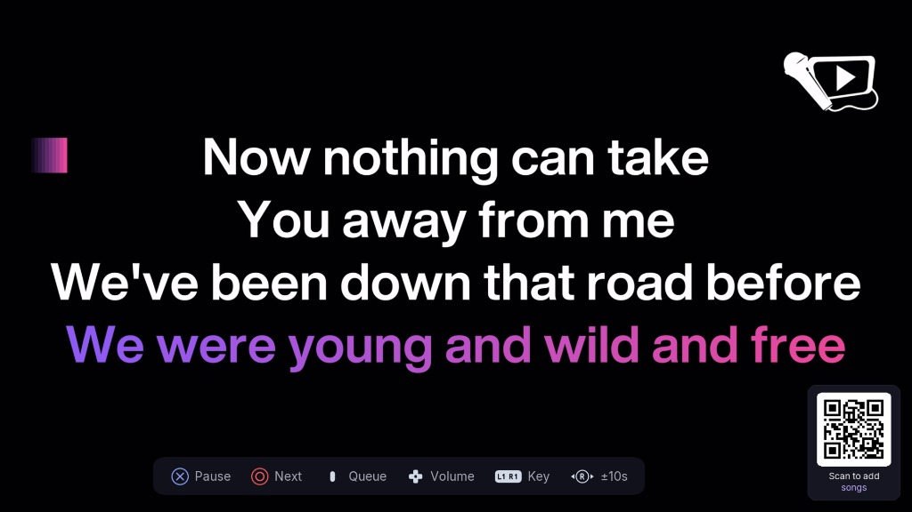
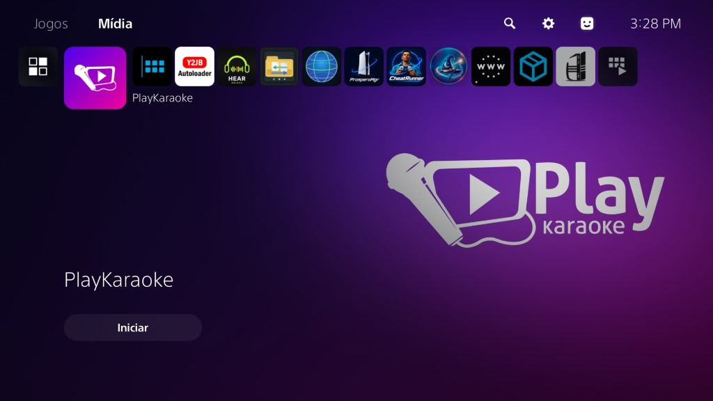
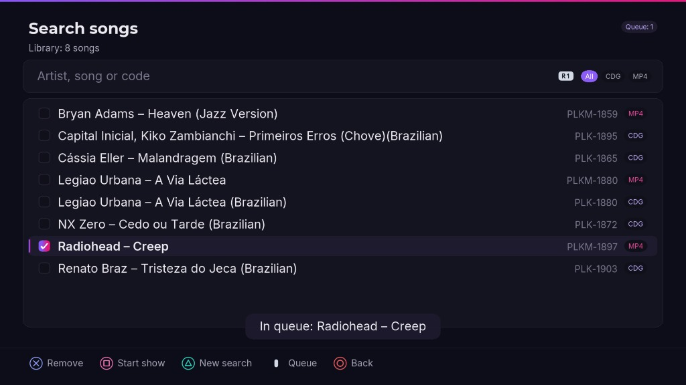
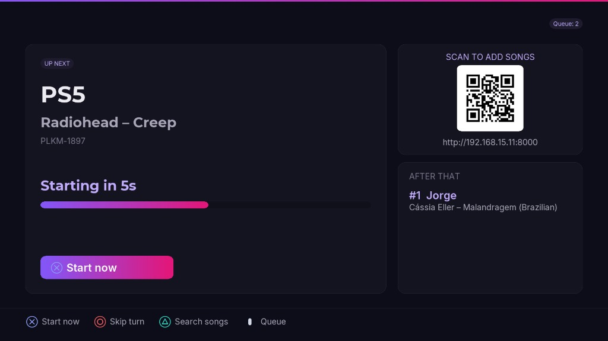
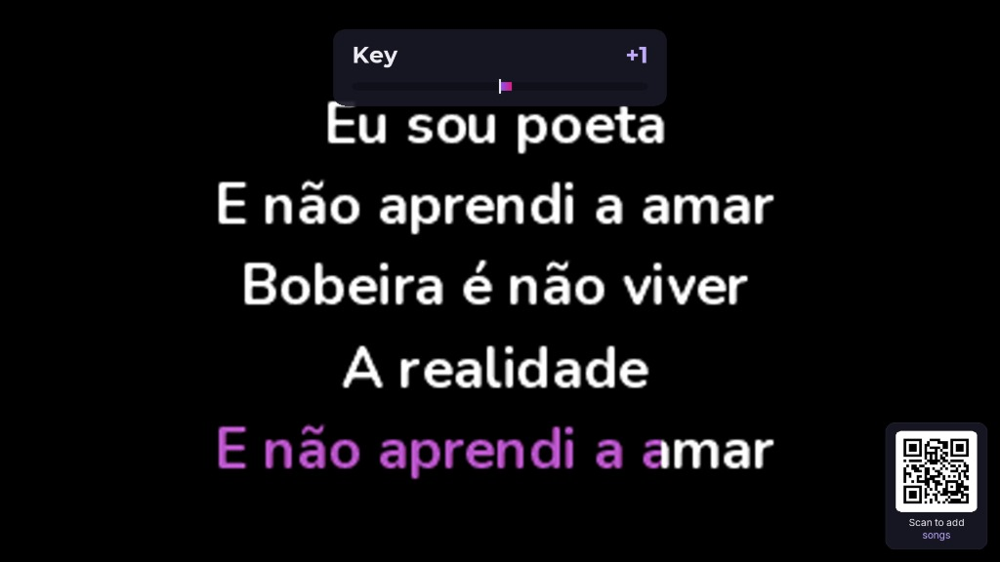
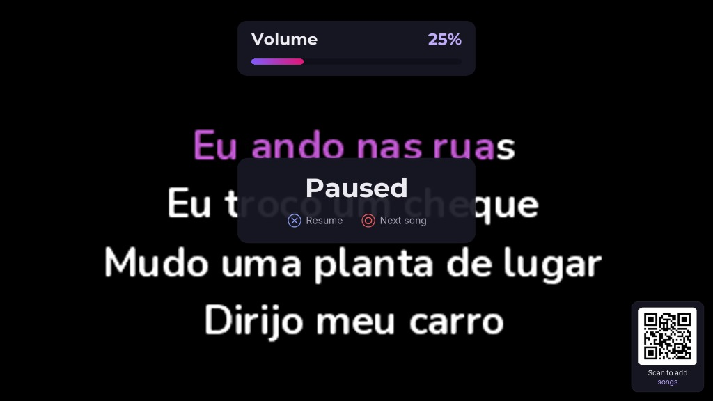
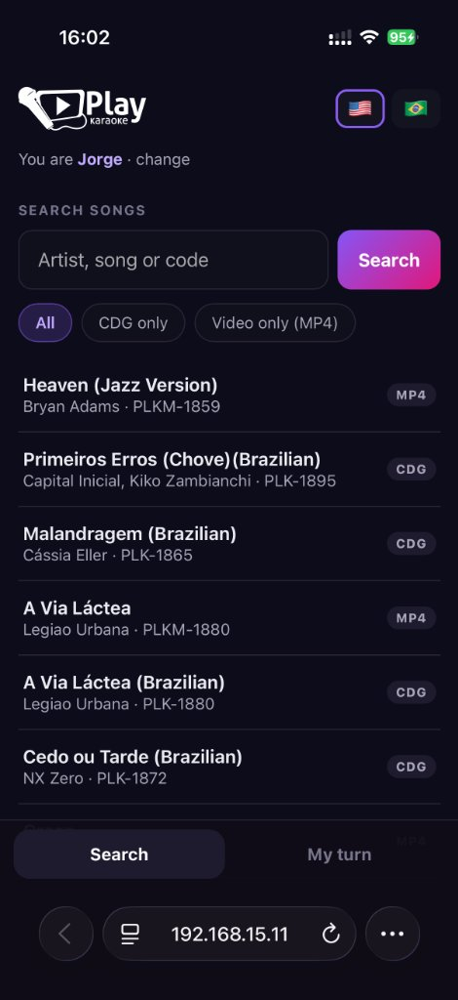
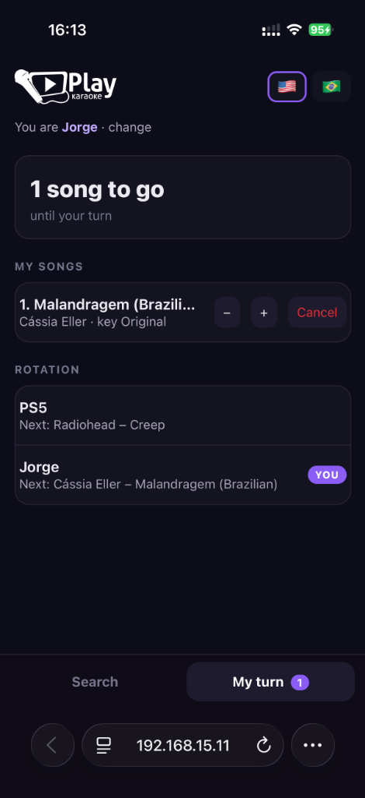

<p align="center">
  
</p>

<h1 align="center">PlayKaraoke for PS5</h1>

<p align="center">
  <strong>A native, 100% offline karaoke player for jailbroken PlayStation 5 consoles.</strong><br/>
  CDG (MP3+G) and 4K MP4 playback · Real-time ±12 semitone pitch shifting · Fair singer rotation · Mobile guest requests via QR code.
</p>

<p align="center">
  <a href="https://github.com/PlayKaraoke/PS5-PlayKaraoke-Player/releases/latest"></a>
  
  
  <a href="LICENSE"></a>
</p>

<p align="center">
  
  
</p>

> [!WARNING]
> **Experimental homebrew — use at your own risk.** PlayKaraoke runs on a jailbroken PS5 and registers a Media dashboard tile (`/user/app/PLKR00001`). It has no affiliation with Sony. Back up your saves and **close any running game before opening PlayKaraoke** (PlayKaraoke also refuses to launch if another game/app is running).

> [!NOTE]
> **No music included.** PlayKaraoke is strictly a local media player. It does not bundle, distribute, or stream copyrighted karaoke files. Only use karaoke files you have the right to use.

---

## Highlights

- **100% Local & Offline:** No internet connection required. Load songs from a **USB drive (exFAT / FAT32)** or copy them directly to the PS5 internal storage at **`/data/playkaraoke/songs/`** (via FTP). Both sources are indexed and merged seamlessly into search.
- **CDG (MP3+G) & MP4 Playback:** Plays `.zip` archives (`.cdg` + `.mp3`/`.wav`/`.ogg`/`.m4a`) with bicubic upscaling and `.mp4` videos up to 4K via FFmpeg 7.1.
- **Real-Time Key Change (±12 Semitones):** Adjust pitch live without changing tempo on both CDG and MP4 tracks, from the DualSense or the singer's phone.
- **Phone Guest Interface:** Guests scan the on-screen QR code on the same Wi-Fi to browse the library, request songs, check how many songs remain until their turn, adjust their key, or finish their song live.
- **Fair Singer Rotation:** One song per singer per round, in order of arrival, up to 5 queued songs per guest.
- **PLK 2027 Dark UI:** Designed for 1080p living-room TVs with high-contrast cards, DualSense button prompts, translucent playback OSDs, and a matching mobile web interface.
- **Bilingual:** English (default) and Portuguese (`L1` / `R1` on the home screen).

---

## Screenshots

<p align="center">
  
  
  
  
  
  
</p>

<p align="center">
  
  
</p>

---

## Requirements

| Requirement | Details |
|---|---|
| **Console** | Jailbroken PS5 with **elfldr** (port `9021`). Tested on **firmware 13.60**; earlier firmwares running elfldr should work. |
| **Songs** | **USB drive** formatted as **exFAT** or **FAT32** (NTFS/APFS are not supported by PS5), **or** internal storage at `/data/playkaraoke/songs/` via FTP. |
| **Network** | Optional. Phones must be on the **same local Wi-Fi** as the PS5 (no internet access needed). |

---

## Installation & Quick Start

### Option 1 — Native PS5 App (`PLKR00001.zip`, Recommended)
Runs directly from the PS5 Media dashboard with **no browser popup** via ShadowMountPlus / ProsperoStore:

1. Download `PLKR00001.zip` from the [latest release](https://github.com/PlayKaraoke/PS5-PlayKaraoke-Player/releases/latest) (or install directly from **ProsperoStore** / `homebrew.page`).
2. Extract and copy the `PLKR00001/` folder to `/data/homebrew/PLKR00001/` on your PS5.
3. Let **ShadowMountPlus** register the title, then open **PlayKaraoke** in the **Media** section of the home screen.

### Option 2 — Standalone Payload (`playkaraoke.elf`)
1. Download `playkaraoke.elf` from the [latest release](https://github.com/PlayKaraoke/PS5-PlayKaraoke-Player/releases/latest).
2. Send it to the PS5 `elfldr` (port `9021`):
   ```bash
   nc -q0 <PS5-IP> 9021 < playkaraoke.elf
   ```
3. Open **PlayKaraoke** in the **Media** section (press **○** once to close the launcher browser overlay).

### Adding Songs

- **Option A — USB Drive:** Plug in an exFAT/FAT32 USB drive before opening the app. Any folder layout works; PlayKaraoke scans recursively in the background.
- **Option B — PS5 Internal Storage:** Connect to your PS5 over FTP (port `2121`) and upload `.zip` (CDG) or `.mp4` files to:
  ```text
  /data/playkaraoke/songs/
  ```

### File Naming Convention

Metadata is parsed automatically from filenames (`Code - Artist - Title`):

```text
SC8123-05 - Artist Name - Song Title.zip   → code, artist, title
Artist Name - Song Title.mp4                → artist, title
```

A `.zip` file must contain one `.cdg` file and its matching audio track (`.mp3`, `.wav`, `.ogg`, or `.m4a`).

---

## DualSense Controls

| Screen | Button | Action |
|---|---|---|
| **Home** | `△` / `▢` / `✕` / `○` | Search songs / Folders / Start show / Quit |
| **Home** | `L1` / `R1` | Portuguese (`PT-BR`) / English (`EN`) |
| **Search** | `✕` / `▢` / `△` | Add or remove from queue / Start show / Type search |
| **Search** | `R1` | Filter: `All` · `CDG` · `MP4` |
| **Anywhere** | `OPTIONS` | Open Queue (`✕` move song, `△` remove song) |
| **Countdown** | `✕` / `○` | Start now / Skip turn |
| **Playing** | `✕` / `○` | Pause & resume / End song |
| **Playing** | `D-Pad ↑↓` or `Left Stick` | Volume |
| **Playing** | `L1` / `R1` | Key −1 / +1 semitone |
| **Playing** | `Right Stick ← →` | Seek −10s / +10s |
| **Playing** | `Touchpad` or `△` | Show translucent controls bar |

---

## Architecture

```text
┌─────────────────── PS5 (playkaraoke.elf) ───────────────────┐
│  Resident Launcher (127.0.0.1:9050) ──► BigApp (app.elf)    │
│                                           │                 │
│   ┌──────────────┐   ┌────────────────────┴────┐   ┌─────┐  │
│   │ Queue & State│◄──┤ FFmpeg 7.1 + CDG + Pitch│──►│SDL2 │──┼─► TV (1080p)
│   └──────┬───────┘   └─────────────────────────┘   └─────┘  │
│          │                                                  │
│   ┌──────┴────────────────┐   ┌──────────────────────────┐  │
│   │ HTTP Server (:8000)   │   │ Local Library Scanner    │  │
│   │ libmicrohttpd         │   │ /mnt/usb* + /data/.../   │  │
│   └──────┬────────────────┘   └──────────────────────────┘  │
└──────────┼──────────────────────────────────────────────────┘
           │ Local Wi-Fi (no internet)
    📱 Guest Phones (embedded mobile web UI)
```

---

## Building from Source

Requires **Docker**. The container uses [ps5-payload-sdk](https://github.com/ps5-payload-dev/sdk) and [PacBrew](https://github.com/ps5-payload-dev/pacbrew-repo) (`v0.41.1`).

```bash
./tests/run.sh                           # Run host unit tests
./scripts/ps5.sh release                 # Build public dist/playkaraoke.elf (DEV=0)
./scripts/ps5.sh build                   # Build development build/playkaraoke.elf (DEV=1)
PS5_HOST=<PS5-IP> ./scripts/ps5.sh       # Build and send to elfldr
```

---

## Credits & License

PlayKaraoke for PS5 is licensed under **GPL-3.0-or-later** (see [LICENSE](LICENSE)).

| Component | License | Notes |
|---|---|---|
| BigApp loader core (`src/launcher/core`) from [ps5-payload-websrv](https://github.com/ps5-payload-dev/websrv) by John Törnblom | GPL-3.0-or-later | Commit `7748df9`; adapted for `PLKR00001` Media tile |
| Native PS5 FSELF builder & clean-room `libc.prx` from [ProsperoTV / ps5-native-app-boilerplate](https://github.com/blackbearreloaded/ProsperoTV) by BlackBearReloaded | GPL-3.0-or-later | Used to package `PLKR00001/eboot.bin` |
| [qrcodegen](https://github.com/nayuki/QR-Code-generator) by Project Nayuki (`vendor/qrcodegen`) | MIT | v1.8.0 |
| [ps5-payload-sdk](https://github.com/ps5-payload-dev/sdk) | GPL-3.0-or-later | Toolchain & runtime |
| SDL2, SDL2_ttf, SDL2_image, SDL2_gfx | zlib | Via PacBrew |
| FFmpeg 7.1 | LGPL/GPL | Via PacBrew |
| libmicrohttpd | LGPL-2.1 | Via PacBrew |
| minizip, zlib | zlib | Via PacBrew |
| [Inter](https://github.com/rsms/inter) & [Montserrat](https://github.com/JulietaUla/Montserrat) fonts | SIL OFL 1.1 | `assets/fonts` |

The CDG decoder, pitch shifter, singer rotation, and filename parser are ports of the [PlayKaraoke Web Player](https://github.com/PlayKaraoke/PlayKaraokeWebPlayer) by the same author.
